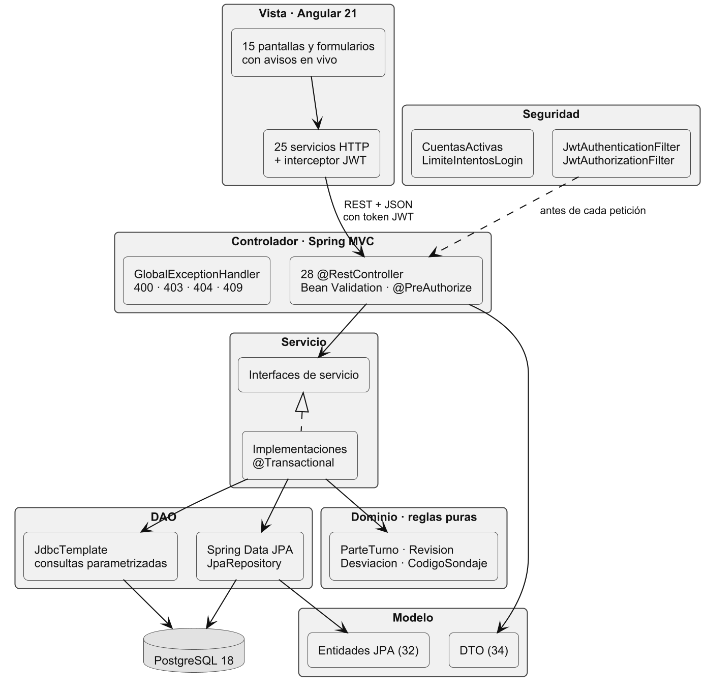
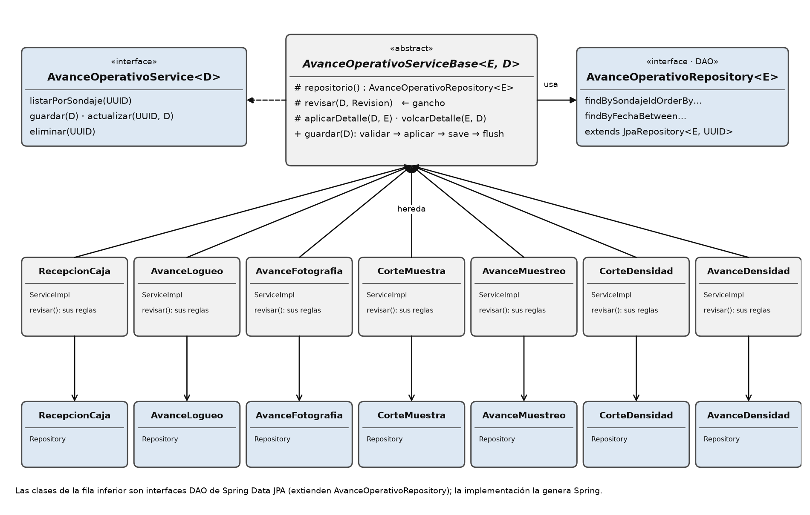
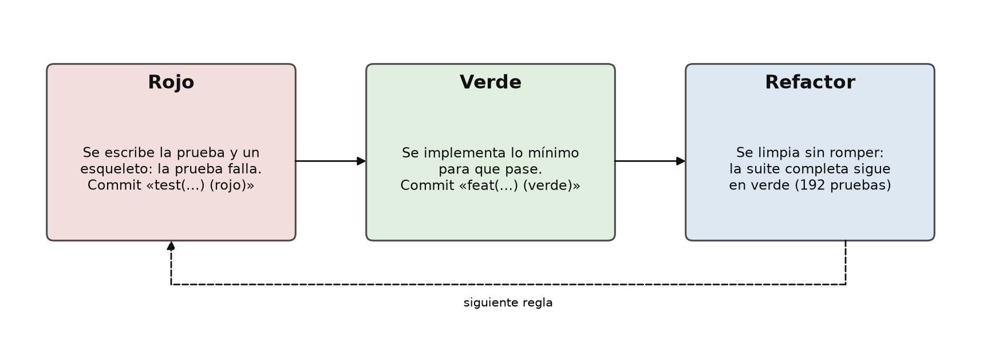

# Boulder Drilling

Plataforma web de gestión de campañas de perforación diamantina. Reemplaza los
reportes dispersos de la campaña —el parte de turno por WhatsApp, el reporte de
almacén, los libros de logueo, el desvío y el quicklog en Excel— por una fuente
única de información validada.

Proyecto integrador del curso, ciclo VI de Ingeniería de Software (UTP, Arequipa).
Autor: Juan Rafael Velazco Vera.

| | |
|---|---|
| Backend | Java 21 · Spring Boot 4 · Spring Security (JWT) · Spring Data JPA |
| Frontend | Angular 21 (componentes standalone, signals) |
| Base de datos | PostgreSQL 18 (esquemas `base`, `operacional`, `logueo`) |
| Librerías | Google Guava · Apache POI · Apache Commons (Lang, IO) · Logback |
| Calidad | JUnit 5 · Mockito · MockMvc · AssertJ · JaCoCo · Javadoc |

## Estado

El alcance comprometido en el APF2 está implementado: 15 requisitos funcionales,
22 casos de uso y 15 pantallas.

| RF | Requisito | CU | Pantalla |
|---|---|---|---|
| RF01 | Iniciar sesión y elegir rol | CU01 | P01 |
| RF02 | Cambiar contraseña | CU02 | P14 Mi cuenta |
| RF03 | Gestionar usuarios y roles | CU03–CU05 | P13 |
| RF04 | Gestionar diccionarios geológicos | CU06 | P15 |
| RF05 | Gestionar plataformas y máquinas | CU07 | P12 |
| RF06 | Gestionar sondajes | CU08 | P03 |
| RF07 | Registrar parte diario de perforación | CU09 | P04 |
| RF08 | Registrar medición de desvío | CU10 | P07 |
| RF09 | Dar seguimiento al desvío | CU11 | P07, P08 |
| RF10 | Registrar avances de almacén | CU12–CU17 | P05 |
| RF11 | Registrar avance de logueo | CU18 | P06 |
| RF12 | Registrar quicklog | CU19 | P09 |
| RF13 | Consultar frente de avance | CU20 | P02 |
| RF14 | Cargar datos desde plantillas Excel | CU21 | P10 |
| RF15 | Generar reporte diario consolidado (Excel y PDF) | CU22 | P11 |

## Arquitectura

Aplicación en capas con MVC del lado del servidor y acceso a datos por DAO. La
vista es la aplicación Angular, que consume el API REST con un token JWT.



- **Controlador** (`controllers/`, 28 clases): traduce HTTP a llamadas de servicio,
  valida el cuerpo con Bean Validation y elige el código de estado.
- **Servicio** (`services/`): reglas de negocio y transacciones. Cada servicio es
  una interfaz con su implementación.
- **DAO** (`repositories/`, 33): Spring Data JPA y, donde el SQL es más claro,
  `JdbcTemplate`. Los valores viajan siempre como parámetros.
- **Modelo** (`entities/`, `dto/`): el API nunca expone una entidad.
- **Dominio** (`dominio/`): reglas puras sin Spring ni base de datos
  (`ParteTurno`, `Revision`, `Desviacion`, `CodigoSondaje`). Las comparten los
  formularios y el importador de Excel.

Los siete partes de testigo comparten un servicio base (patrón plantilla) y cada
uno declara solo sus reglas:



Cómo se aplica cada principio SOLID: [docs/arquitectura/solid.png](docs/arquitectura/solid.png).
El detalle por paquete está en el Javadoc.

## Seguridad

- Contraseñas con BCrypt; sesión con JWT firmado (HMAC-SHA256).
- Credenciales fuera del repositorio: `DB_PASSWORD` y `JWT_SECRET` salen de variables
  de entorno o de `application-local.properties`, que está en `.gitignore`.
- Bloqueo tras 5 intentos fallidos de inicio de sesión durante 15 minutos (caché de
  Guava); responde 429.
- Bitácora de seguridad aparte (`logs/seguridad.log`, Logback, 90 días), sin
  contraseñas y con los datos del cliente saneados contra inyección de líneas.
- Una sola política CORS; las escrituras sensibles exigen rol ADMIN (`@PreAuthorize`);
  el usuario de una operación sale del token, nunca del cuerpo.
- Excel exportado sin fórmulas (texto siempre como texto); nombres de archivo de las
  fotos saneados con Commons IO; nombres de tabla contra una lista blanca.

## Librerías de apoyo

| Librería | Dónde y para qué |
|---|---|
| Google Guava | Caché de intentos fallidos con expiración (`LimiteIntentosLogin`), estructura de catálogos memorizada, colecciones inmutables, `Preconditions` |
| Apache POI | Importador de plantillas `.xlsx` y exportación del reporte diario a Excel |
| Apache Commons Lang | Normalización de códigos de sondaje y textos (`StringUtils`) |
| Apache Commons IO | Nombre de archivo seguro de las fotos (`FilenameUtils`) |
| Logback | Bitácora general y bitácora de seguridad separada |

## Pruebas (TDD)

185 pruebas en 24 clases: unitarias con JUnit y Mockito, de la capa web con MockMvc
y de integración contra PostgreSQL (cada una se deshace al terminar). El historial
muestra el ciclo: un commit `test(…) (rojo)` con la prueba que falla y el siguiente
`feat(…) (verde)` con lo que la hace pasar.



| Cobertura (JaCoCo) | |
|---|---|
| Líneas | 54.9 % |
| Ramas | 45.2 % |
| Métodos | 56.9 % |
| Clases | 94.4 % |

```bash
./gradlew test jacocoTestReport
```

## Documentación

- [Javadoc](docs/javadoc/index.html): arquitectura, MVC/DAO y SOLID explicados por paquete.
- [Reporte de cobertura](docs/cobertura/index.html).
- [Diagramas de arquitectura](docs/arquitectura/).
- Entregables del curso: [`integrador/`](integrador/) (APF2 con BPMN, modelo de datos,
  casos de uso y prototipo).

## Control de versiones

El trabajo se reparte en tres ramas de rol que se integran a `develop` con merges
explícitos (`--no-ff`), como pull requests aceptados; `main` recibe cada entrega
etiquetada.

| Rama | Rol |
|---|---|
| `backend` | API, dominio, seguridad y pruebas del servidor |
| `frontend` | Pantallas Angular y servicios HTTP |
| `docs-qa` | Documentación, entregables, cobertura y pruebas de integración |
| `develop` | Integración |
| `main` | Entregas (`v0.3-apf3`) |

Los mensajes siguen *Conventional Commits* en español: `feat`, `fix`, `test`,
`refactor`, `docs`, `build`, `chore`, con el área entre paréntesis.

## Puesta en marcha

Requisitos: Java 21, Node.js 20 o superior y PostgreSQL 16 o superior. El Gradle
Wrapper viene incluido.

1. **Base de datos.**

   ```bash
   createdb -U postgres boulder_db
   psql -U postgres -d boulder_db -f integrador/APF2_entrega/anexos/B_base_datos/boulder_db_esquema_fisico.sql
   ```

2. **Credenciales.** Copiar `src/main/resources/application-local.properties.example`
   como `application-local.properties` y completar `DB_PASSWORD` y `JWT_SECRET`
   (al menos 32 caracteres aleatorios). Ese archivo no se versiona.

3. **Backend** (puerto 8080).

   ```bash
   ./gradlew bootRun
   ```

4. **Frontend** (puerto 4200).

   ```bash
   cd boulder-app
   npm install
   npm start
   ```

## Estructura

```
src/main/java/com/boulder/boulder/
  config/        seguridad, CORS, manejo de errores, reloj
  controllers/   API REST
  services/      reglas de negocio (+ importacion/ con Apache POI)
  repositories/  DAO
  entities/ dto/ modelo
  dominio/       reglas puras
  reportes/      reporte diario (consulta, armado, Excel, API)
  fotos/ eventos/
src/test/java/   pruebas unitarias, web e integración
boulder-app/     frontend Angular
docs/            arquitectura, Javadoc y cobertura
integrador/      entregables del curso
```
